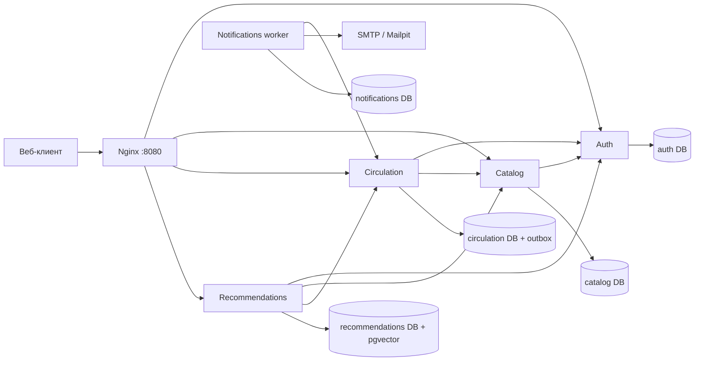

# Бэкенд библиотеки

Проект теперь включает React/TypeScript-фронтенд в `frontend/`. Единый запуск и проверка интерфейса описаны в [FULLSTACK.md](FULLSTACK.md). Команда `docker compose up -d --build` собирает и запускает весь проект, а `http://localhost:8080` открывает веб-приложение и обслуживает API на том же origin.

Python 3.12, FastAPI, PostgreSQL 17, pgvector, Nginx, SMTP и Sentence Transformers на PyTorch. Пять независимых процессов с отдельными базами данных; сервисы общаются через HTTP. Один PostgreSQL-кластер используется для удобства запуска. Базы можно перенести на отдельные серверы, изменив строки подключения.

## Быстрый запуск

Потребуются Docker Desktop с запущенным Linux engine и Docker Compose v2. Выполняйте команды из этой корневой папки проекта.

Если установлен Python, `python scripts/configure.py` автоматически создаст `.env` со случайными секретами. Скрипт отказывается перезаписывать существующий файл. Если Python не установлен, используйте ручной способ ниже.

```powershell
Copy-Item .env.example .env
```

Отредактируйте `.env`: замените четыре секрета случайными независимыми значениями. Для `SERVICE_DB_PASSWORD` используйте длинную случайную строку из букв и цифр: она вставляется в URL подключения. Не коммитьте `.env`. Секрет JWT — минимум 32 случайных байта. Можно получить отдельное значение командой Python `python -c "import secrets; print(secrets.token_hex(32))"`.

```powershell
docker compose up -d --build
docker compose ps
docker compose logs migrate
docker compose exec auth python scripts/admin.py
```

Последняя команда интерактивно создаёт первого администратора; пароль не записывается в файлы и не передаётся аргументом процесса. Администратор затем назначает сотрудников через API. Повторное выполнение команды обновляет пароль и отзывает предыдущие токены данного администратора.

API: `http://localhost:8080`; тестовый почтовый ящик Mailpit: `http://localhost:8025`. Отдельные сервисы и PostgreSQL не имеют опубликованных портов. Первый AI-запрос скачивает модель из Hugging Face; нужны интернет и свободное место. Установленные зависимости закреплены версиями, но образы имеют теги: для воспроизводимого промышленного релиза закрепите их digest после проверки в вашей инфраструктуре.

Остановка с сохранением данных: `docker compose down`. Том `postgres` хранит данные; `models` хранит модель. Не удаляйте тома рабочей системы. Начальная инициализация баз запускается только на новом томе. Изменение пароля в `.env` не меняет пароль уже существующих ролей PostgreSQL: измените его в БД и конфигурации согласованно.

## Архитектура



`app/common.py` содержит подключение к БД и зависимости доступа. JWT подписывает только auth: другие сервисы проверяют пользователя через `/auth/me`, поэтому смена роли и logout действуют сразу. Внутренние HTTP-запросы защищены отдельным секретом `X-Internal-Token`; Nginx не публикует `/internal/*`.

## Роли

| Возможность | Посетитель | Читатель | Сотрудник | Администратор |
|---|---|---|---|---|
| Чтение каталога и доступности | Да | Да | Да | Да |
| Семантический поиск | Да | Да | Да | Да |
| Регистрация / вход | Да | Да | Да | Да |
| Свои бронирования, отмена, рекомендации | — | Да | Да | Да |
| CRUD книг, авторов, жанров, экземпляров | — | — | Да | Да |
| Выдача, возврат, просмотр всех броней | — | — | Да | Да |
| Просмотр пользователей и назначение ролей | — | — | — | Да |

Регистрация всегда создаёт `reader`: переданный клиентом `role` не назначается. Пароли хешируются Argon2. Access token живёт 30 минут. После истечения нужен повторный вход; refresh tokens в данной реализации отсутствуют. Logout отзывает все токены пользователя. Последнего активного администратора нельзя понизить через API. Nginx ограничивает частоту регистрации и входа по IP.

## Эндпоинты

JSON в UTF-8; авторизация `Authorization: Bearer <access_token>`. Для дат обязательны часовой пояс и ISO 8601, например `2026-10-05T10:00:00+03:00`. PostgreSQL хранит абсолютные моменты времени.

| Метод | Путь | Действие |
|---|---|---|
| POST | `/auth/register` | `{email,password}`; пароль 12–128 символов |
| POST | `/auth/login` | `{email,password}` → токен |
| GET | `/auth/me` | Текущий пользователь |
| POST | `/auth/logout` | Отзыв токенов |
| GET | `/auth/users` | Пользователи; администратор |
| PATCH | `/auth/users/{id}/role` | `{role: reader\|staff\|admin}` |
| PATCH | `/auth/users/{id}/state` | `{active:false}` — блокировка, `{active:true}` — восстановление; администратор |
| GET | `/catalog/books?q=&offset=0&limit=50` | Поиск по названию и пагинация |
| GET | `/catalog/books/{id}` | Книга, авторы и жанры |
| POST | `/catalog/books` | Создание книги |
| PUT | `/catalog/books/{id}` | Полная замена полей книги |
| DELETE | `/catalog/books/{id}` | Архивирование книги |
| GET / POST | `/catalog/authors`, `/catalog/genres` | Список / создание `{name}` |
| PUT / DELETE | `/catalog/authors/{id}`, `/catalog/genres/{id}` | Изменение / удаление |
| POST | `/circulation/copies` | `{book_id,barcode}` |
| DELETE | `/circulation/copies/{id}` | Списание экземпляра без активных броней/выдач |
| GET | `/circulation/copies?book_id=…&starts_at=…&ends_at=…` | Экземпляры с признаком `available` |
| POST | `/circulation/reservations` | `{copy_id,starts_at,ends_at}` |
| GET | `/circulation/reservations` | Собственные брони и выдачи |
| GET | `/circulation/bookings` | Все брони и выдачи; сотрудник |
| POST | `/circulation/reservations/{id}/cancel` | Отмена своей брони; сотрудник может отменить чужую |
| POST | `/circulation/reservations/{id}/checkout` | Выдача по текущей брони; сотрудник |
| POST | `/circulation/loans/{id}/return` | Возврат; сотрудник |
| POST | `/recommendations/reindex` | Перестроение векторного индекса; сотрудник |
| POST | `/recommendations/search` | `{query,limit}` → книги и cosine score |
| GET | `/recommendations/me?limit=10` | Рекомендации по истории выданных/возвращённых книг |

Поле книги: `{title,description,isbn,author_ids:[1],genre_ids:[1]}`. Авторы и жанры должны существовать. ISBN уникален, если указан. Ссылочный автор/жанр не удаляется: вернётся 409. Архивирование книги сохраняет историю; новые брони и экземпляры для неё запрещены. Уже созданную бронь можно обслужить. Чтобы полностью убрать книгу из обращения, отмените её брони и спишите экземпляры после возврата.

Ошибки: 401 — недействительный токен/учётные данные; 403 — недостаточно прав; 404 — объект отсутствует; 409 — конфликт состояния или времени; 422 — невалидные данные; 503 — зависимый сервис недоступен. Отсутствующий bearer токен в используемой версии FastAPI может давать 403.

OpenAPI каждого сервиса доступен внутри сети Compose. Например, `docker compose exec catalog python -c "import urllib.request; print(urllib.request.urlopen('http://localhost:8000/openapi.json').read().decode())"`. Для локального запуска отдельного сервиса Swagger находится на `/docs`. Внешний gateway публикует только бизнес-маршруты.

## Правила бронирования и выдачи

Бронируется физический экземпляр, а не название. Интервалы полуоткрытые `[starts_at, ends_at)`: следующая бронь может начинаться точно в момент окончания предыдущей. Длительность — от положительного значения до 60 дней, начало — в будущем (допуск 5 секунд на транспорт). Увеличение срока оформляется новой бронью, автоматического продления нет.

PostgreSQL `EXCLUDE USING gist` запрещает пересечения активных интервалов. Это защищает и прямые записи в БД. HTTP-операции также блокируют строку экземпляра, чтобы согласовать бронирование, списание, выдачу и возврат. Частичный UNIQUE-индекс допускает только одну незавершённую выдачу экземпляра.

Состояния: `reserved → loaned → returned`, `reserved → cancelled`, `reserved → expired`. Просроченная выдача остаётся `loaned` до физического возврата. Пока экземпляр просрочен, новые брони запрещены и соседняя существующая бронь не может быть выдана. Уже оформленная будущая бронь сохраняется и сможет обслуживаться после возврата, если её срок ещё не истёк. Доступность — снимок состояния, окончательное решение принимает транзакция POST.

Выдача без предварительной брони оформляется сотрудником в два шага: читатель создаёт текущую бронь, сотрудник выдаёт её. Если сотрудник оформляет бронь самостоятельно своим токеном, она принадлежит сотруднику; API намеренно не принимает произвольный `user_id` от читателя.

## Уведомления

Worker раз в 30 секунд проверяет брони. Создаются письма при наступлении доступной брони, истечении неиспользованной брони, просрочке возврата, выдаче и возврате. Если предыдущий читатель задержал экземпляр, приглашение на получение откладывается до возврата. Каждый тип уведомления для брони создаётся один раз по уникальному ключу события.

Outbox записывается в одной транзакции с выдачей/возвратом. Worker сначала сохраняет событие в собственной базе, затем подтверждает его исходному сервису. Ошибка SMTP приводит к повторной попытке с задержкой до часа. Доставка имеет семантику **at least once**: сбой после принятия SMTP и до фиксации `sent_at` может дать повторное письмо. Стабильный Message-ID помогает диагностике, но не гарантирует дедупликацию почтовым провайдером. Неуспешные письма не удаляются.

Для реальной почты задайте `SMTP_HOST`, `SMTP_PORT=587`, `SMTP_TLS=true`, `SMTP_USER`, `SMTP_PASSWORD`, `SMTP_FROM` в `.env`, затем пересоздайте worker: `docker compose up -d --force-recreate notifications`. Реализован STARTTLS; для SMTP с обязательным implicit TLS на 465 адаптируйте транспорт на `SMTP_SSL`.

## ИИ и векторный поиск

`app/recommendations.py` использует `sentence-transformers/paraphrase-multilingual-MiniLM-L12-v2`, размерность 384. Модель работает на PyTorch, поддерживает русский язык, кодирует название, описание, авторов и жанры. PostgreSQL хранит embedding и индекс HNSW; используется cosine distance. Фронтенд после изменения каталога запускает `/recommendations/reindex`; при использовании API напрямую вызывайте переиндексацию самостоятельно. Удалённые книги дополнительно фильтруются по живому каталогу. Изменённый текст до переиндексации имеет старый embedding.

Персональные рекомендации используют текст книг из истории выдач и параметр `interests`; прочитанные книги исключаются. Без истории применяется нейросетевой поиск по интересам, а если они ещё не заданы — по стартовому литературному запросу. `basis` принимает `reading_history`, `interests` или `neural_discovery`. Каждый результат имеет вычисленный cosine score. Если индекс не готов, сервис возвращает 503, а интерфейс показывает объяснение. Подмена рекомендаций обычным списком каталога удалена. Это готовая среда для нейросетевого поиска и базовая содержательная рекомендательная функция; обученный на поведении ваших читателей персональный ranking требует отдельного датасета и оценки качества.

Для масштабирования замените полную переиндексацию на фоновые пакетные задания и события каталога, добавьте отзывы/оценки и метрики Recall@K/NDCG. При замене модели сохраните идентификатор модели и измените схему размерности, если она другая; сервис проверяет 384 измерения. Модель загружается лениво. Не запускайте несколько тяжёлых worker-процессов AI без оценки памяти. `AI_DEVICE=cuda` потребует NVIDIA Container Toolkit и GPU-конфигурацию Compose; по умолчанию CPU.

## Пример работы в PowerShell

```powershell
$base = 'http://localhost:8080'
$reader = @{email='reader@example.com'; password='Reader-password-123!'}
Invoke-RestMethod "$base/auth/register" -Method Post -ContentType 'application/json' -Body ($reader | ConvertTo-Json)
$token = (Invoke-RestMethod "$base/auth/login" -Method Post -ContentType 'application/json' -Body ($reader | ConvertTo-Json)).access_token
$headers = @{Authorization="Bearer $token"}

# Войдите под администратором, созданным scripts/admin.py.
$admin = @{email='admin@example.com'; password='Your-admin-password-123!'}
$adminToken = (Invoke-RestMethod "$base/auth/login" -Method Post -ContentType 'application/json' -Body ($admin | ConvertTo-Json)).access_token
$staffHeaders = @{Authorization="Bearer $adminToken"}
$author = Invoke-RestMethod "$base/catalog/authors" -Method Post -Headers $staffHeaders -ContentType 'application/json' -Body (@{name='Айзек Азимов'} | ConvertTo-Json)
$genre = Invoke-RestMethod "$base/catalog/genres" -Method Post -Headers $staffHeaders -ContentType 'application/json' -Body (@{name='Фантастика'} | ConvertTo-Json)
$book = Invoke-RestMethod "$base/catalog/books" -Method Post -Headers $staffHeaders -ContentType 'application/json' -Body (@{title='Основание'; description='Галактическая империя и психоистория'; author_ids=@($author.id); genre_ids=@($genre.id)} | ConvertTo-Json)
$copy = Invoke-RestMethod "$base/circulation/copies" -Method Post -Headers $staffHeaders -ContentType 'application/json' -Body (@{book_id=$book.id; barcode='FOUNDATION-001'} | ConvertTo-Json)
$start = [DateTimeOffset]::UtcNow.AddSeconds(2)
$body = @{copy_id=$copy.id; starts_at=$start.ToString('o'); ends_at=$start.AddDays(7).ToString('o')} | ConvertTo-Json
$booking = Invoke-RestMethod "$base/circulation/reservations" -Method Post -Headers $headers -ContentType 'application/json' -Body $body
Start-Sleep -Seconds 3
Invoke-RestMethod "$base/circulation/reservations/$($booking.id)/checkout" -Method Post -Headers $staffHeaders
Invoke-RestMethod "$base/circulation/loans/$($booking.id)/return" -Method Post -Headers $staffHeaders
Invoke-RestMethod "$base/recommendations/reindex" -Method Post -Headers $staffHeaders
Invoke-RestMethod "$base/recommendations/search" -Method Post -ContentType 'application/json' -Body (@{query='фантастика о космосе'; limit=5} | ConvertTo-Json)
```

Пример создаёт новые объекты. Повторная регистрация того же адреса и создание того же штрихкода дадут ожидаемый 409. Для назначения сотрудника используйте PATCH `/auth/users/{id}/role` с `{"role":"staff"}` и токеном администратора; затем сотруднику нужно заново войти.

## Тесты

`tests/test_integration.py` обращается к реальным HTTP-сервисам, PostgreSQL и Mailpit. Тестовые фикстуры меняют роли и время в БД: **запускайте только на отдельном стеке**, не на рабочих данных. Другой project name создаёт отдельные тома, но публикуемые порты совпадают: сначала остановите обычный стек без удаления его томов.

```powershell
docker compose down
docker compose -p library-test -f compose.yaml -f compose.test.yaml up -d --build auth catalog circulation recommendations notifications mailpit
docker compose -p library-test -f compose.yaml -f compose.test.yaml run --rm tests
```

Проверяются роли, неверные токены, повторная регистрация, CRUD, запрет внутренних запросов, восемь одновременных броней (успех ровно у одной), соседние интервалы, владение бронью, отмена, выдача/возврат, просрочки, одно событие на уведомление, реальное поступление письма в Mailpit и отзыв JWT.

Нейросетевой тест по умолчанию пропущен, чтобы обычные тесты не зависели от загрузки весов. Для полной проверки добавьте:

```powershell
$env:RUN_AI_TESTS = 'true'
docker compose -p library-test -f compose.yaml -f compose.test.yaml run --rm tests
Remove-Item Env:RUN_AI_TESTS
```

Результат JUnit: `test-results/junit.xml`. Успешный exit code — 0. Просмотрите summary: нейросетевой тест должен быть `PASSED`, если включён. После тестов остановите стек: `docker compose -p library-test -f compose.yaml -f compose.test.yaml down`. Тестовые тома сохраняются; для чистого повторного запуска удаляйте только тома тестового project после проверки имени. На заполненном Mailpit проверка ищет адрес тестового читателя, а не произвольное письмо.

Быстрые статические проверки:

```powershell
python -m compileall -q app scripts tests
docker compose -f compose.yaml -f compose.test.yaml config --quiet
```

Проверки безопасности и валидации без PostgreSQL:

```powershell
python -m venv .venv
.\.venv\Scripts\python.exe -m pip install -r requirements.txt
.\.venv\Scripts\python.exe -m scripts.check_imports
.\.venv\Scripts\python.exe -m pytest -v tests/test_contract.py
```

GitHub Actions workflow `.github/workflows/ci.yml` поднимает изолированный стек и запускает также реальный нейросетевой тест. Локальные contract-тесты проверяют отказ по ролям, JWT с неправильной подписью/issuer/audience, срок токена, защищённые внутренние маршруты и корректность интервалов; они не заменяют интеграционные тесты с БД.

## Развёртывание

1. Linux-сервер с Docker/Compose; исходники и `.env` с ограниченным доступом. Примерный стартовый ресурс — 4 CPU, 8 GB RAM и достаточно диска для образов PyTorch, весов и БД; измерьте нагрузку на вашем каталоге.
2. Сборка в CI, прогон изолированных интеграционных и AI-тестов, публикация собственных образов с неизменяемыми тегами/digest. Для production используйте образы из registry вместо сборки на сервере.
3. Выполнение миграций перед запуском новых версий. Новые миграции добавляйте файлами `sql/<service>_002_*.sql`; уже применённые файлы не редактируйте. Миграции записываются в `schema_migrations`, выполняются транзакционно и защищены advisory lock.
4. TLS reverse proxy перед `127.0.0.1:8080`, например Caddy/Nginx на хосте. Все внешние токены передавайте по HTTPS. Если frontend на другом origin, настройте конкретные разрешённые origin и обработку CORS, либо проксируйте API с того же домена. Текущая конфигурация предполагает один origin.
5. Внешний SMTP с STARTTLS; Mailpit в production уберите. Перенесите секреты в secret manager. Для строгой изоляции задайте отдельные пароли для каждой DB-роли вместо общего демонстрационного пароля, ограничьте CONNECT и сетевой доступ. Учётные записи приложений не являются superuser.
6. Регулярные резервные копии каждой из пяти баз и проверка восстановления. Мониторинг `/health` внутри сети, логов worker, возраста неотправленных `messages`, outbox, места на диске, времени запросов и просроченных выдач. Health worker отключён: его работоспособность контролируйте через мониторинг очереди/логов.
7. Для обновления сохраните резервные копии, выполните миграции, затем `docker compose up -d --build`. После изменения каталога перестройте AI-индекс. При смене JWT-secret все токены становятся недействительными.

Пример резервного копирования без повреждения бинарного stdout в Windows PowerShell: создайте файл **внутри контейнера** и скопируйте его наружу.

```powershell
docker compose exec db pg_dump -U postgres -d circulation -Fc -f /tmp/circulation.dump
docker compose cp db:/tmp/circulation.dump ./circulation.dump
```

Повторите для `auth`, `catalog`, `notifications`, `recommendations`. Восстановление сначала проверяйте на изолированной БД через `pg_restore`; учитывайте роли и версии расширений. Согласованные копии всех сервисов делайте в окно остановки записи либо средствами инфраструктуры.

## Документация технологий

- [PostgreSQL: range types и исключающие ограничения](https://www.postgresql.org/docs/17/rangetypes.html)
- [Sentence Transformers: вычисление embeddings и семантический поиск](https://sbert.net/docs/quickstart.html)
- [pgvector](https://github.com/pgvector/pgvector)

## Статус проверки в среде разработки

Фактические результаты локальных проверок записаны в `VALIDATION.md`. Наличие тестов само по себе не означает, что они прошли: проверяйте результаты полного стека в вашем окружении.
